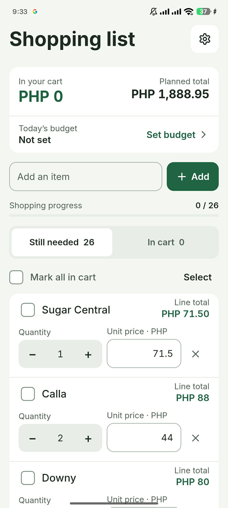

# Grocery List

A simple, phone-friendly grocery list for planning a shopping trip. Add items, adjust quantities and prices, track what is in your cart, compare spending with a daily budget, and save a receipt when the trip is done.

<p align="center">
  
</p>

## Features

- **Plan the list.** Add items, set a unit price, and adjust quantities with **+ / −** or by typing. Quantity can be zero, but never negative. Each item shows its line total.
- **Shop from two tabs.** Check an item to move it from **Still needed** to **In cart**. A progress bar and count show how far along the trip is, and **Mark all in cart** checks or unchecks everything.
- **Watch your spending.** The summary card shows what is in your cart, the planned total, and today's budget with **Remaining** or **Over by**. Tap it to set or clear the daily budget and preview the result as you type.
- **Finish a trip.** On the **In cart** tab, **Finish trip** saves a receipt (date and time, items, total, and that day's budget) and unchecks everything for the next trip.
- **Keep your receipts.** Open **Settings → Receipts** to browse past trips, view the details of each one, or delete it after a confirmation.
- **Choose a currency.** PHP, VND or USD, shown as the code and the amount (for example `PHP 1,240`). This changes formatting only; it does not convert amounts. Each receipt keeps the currency it was made in.
- **Delete safely.** Swipe an item left to reveal a confirmed delete, or tap **×** to delete it immediately with **Undo**. Swipe right to mark it in the cart. Select several items to delete them together.
- **Works the way your phone does.** It follows the system light or dark theme and large text sizes. In the Android app, the system **Back** button closes sheets and dialogs, goes up through Settings, and then sends the app to the background. Checking an item and finishing a trip give light haptic feedback.
- Use the app as a Progressive Web App (PWA) or as an Android app. Back-button handling and haptics apply to the Android app.

## Run locally

### Requirements

- Node.js LTS and npm.
- For Android builds: Android Studio, Android SDK, and Java 21.

Install dependencies and start the development server from the repository root:

```sh
npm ci
npm run dev
```

Vite prints a local URL. To open the app on a phone over the same Wi-Fi network, use the network URL it prints.

## Build for the web

```sh
npm run build
npm run preview
```

The production site is generated in `dist/`. For PWA installation, serve it over HTTPS (or use `localhost`) and choose the browser's **Install app** or **Add to Home Screen** option.

## Run on Android

After changing web code, build it and sync the latest files and plugins into the Capacitor Android project:

```sh
npm run build
npx cap sync android
npx cap open android
```

Run `npx cap sync android` again whenever you add or update a Capacitor plugin (the app uses `@capacitor/app` for the Back button and `@capacitor/haptics` for haptic feedback), or those features silently do nothing.

In Android Studio, select a device or emulator and run the app. To create a debug APK from the command line, use Java 21:

```sh
cd android
./gradlew assembleDebug
```

The debug APK is created in `android/app/build/outputs/apk/debug/`.

## Share an Android release

This project shares APKs privately, rather than through Google Play. The release APK is signed with the same local debug key used for the debug APKs shared with friends. Keep `~/.android/debug.keystore` safe and use the same key for every release so Android accepts updates over existing installs.

The version shown in **Settings → About** comes from `package.json`, so bump it with `npm version x.y.z --no-git-tag-version` and update `versionName` and `versionCode` in `android/app/build.gradle` to match.

For the full version-bump, sync, build, and Drive upload steps, see [docs/release-notes.md](docs/release-notes.md).

## Data and privacy

The app has no account or backend. Grocery items, prices, quantities, the daily budget, the currency choice, and saved receipts are stored in local device storage and are not synchronized across devices. Clearing app or browser data removes the saved list and receipts. A new device starts with an empty list. The daily budget resets for the next local calendar day, but a receipt keeps the budget that applied on its day.

## Project structure

- `src/ui/` — React app state (`hooks/`, including `useGroceryList`, `useBackButton` and `useCompactHeader`) and focused components for the header, summary card, list rows, budget sheet, settings, receipts, and dialogs.
- `src/styles/style.css` — Tailwind utilities plus the app's design tokens (light and dark) and small custom interaction styles.
- `src/domain/` — framework-independent logic for items, totals, budget, and receipts.
- `src/storage/` — local persistence for grocery items, budget, currency, and receipts.
- `public/` — app icons and static assets.
- `assets/` — source artwork.
- `android/` — Capacitor Android project.
- `tests/` — domain, storage, and UI tests.

## Useful commands

| Command | Description |
| --- | --- |
| `npm run dev` | Start the Vite development server. |
| `npm test` | Run the test suite. |
| `npm run build` | Type-check and build the web app. |
| `npx cap sync android` | Copy the web build and plugins into Android. |