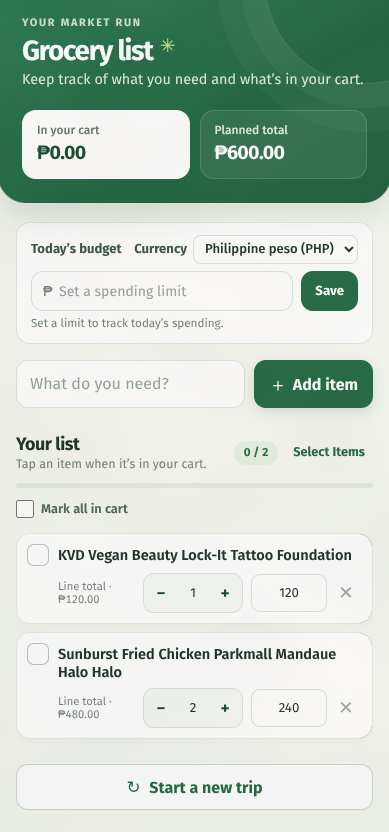

# Grocery List

A simple, phone-friendly grocery list for planning a shopping trip. Add items, adjust quantities and prices, track what is in your cart, and compare spending with a daily budget.

<p align="center">
  
</p>

## Features

- Add items, edit prices, and adjust quantities with **+ / −** controls or by typing. Quantity can be zero, but never negative.
- Swipe an item to reveal a confirmed delete action, or tap **×** to delete it immediately.
- Mark items as in the cart and track cart progress, line totals, and planned spending.
- Set a daily budget and choose PHP, VND, or USD formatting. Currency selection changes formatting only; it does not convert amounts.
- Select and delete multiple items, or clear cart checkmarks to start a new trip.
- Use the app as a Progressive Web App (PWA) or as an Android app.

## Run locally

### Requirements

- Node.js LTS and npm.
- For Android builds: Android Studio, Android SDK, and Java 21.

Install dependencies and start the development server from the repository root:

```sh
npm ci
npm run dev
```

Vite prints a local URL. To open the app on a phone over the same Wi-Fi network, use the network URL it prints.

## Build for the web

```sh
npm run build
npm run preview
```

The production site is generated in `dist/`. For PWA installation, serve it over HTTPS (or use `localhost`) and choose the browser’s **Install app** or **Add to Home Screen** option.

## Run on Android

After changing web code, build it and sync the latest files and plugins into the Capacitor Android project:

```sh
npm run build
npx cap sync android
npx cap open android
```

In Android Studio, select a device or emulator and run the app. To create a debug APK from the command line, use Java 21:

```sh
cd android
./gradlew assembleDebug
```

The debug APK is created in `android/app/build/outputs/apk/debug/`.

## Share an Android release

This project shares APKs privately, rather than through Google Play. The release APK is signed with the same local debug key used for the debug APKs shared with friends. Keep `~/.android/debug.keystore` safe and use the same key for every release so Android accepts updates over existing installs.

For the full version-bump, sync, build, and Drive upload steps, see [docs/release-notes.md](docs/release-notes.md).

## Data and privacy

The app has no account or backend. Grocery items, prices, quantities, and budget settings are stored in local device storage and are not synchronized across devices. Clearing app or browser data removes the saved list. A new device starts with an empty list. The daily budget resets for the next local calendar day.

## Project structure

- `src/ui/` — React app state and focused UI components for the header, budget, list rows, settings, and dialogs.
- `src/styles/style.css` — Tailwind utilities plus the app's theme and small custom interaction styles.
- `src/domain/` — framework-independent grocery, totals, and budget logic.
- `src/storage/` — local persistence for grocery items, budget, and currency.
- `public/` — app icons and static assets.
- `assets/` — source artwork.
- `android/` — Capacitor Android project.
- `tests/` — domain, storage, and UI tests.

## Useful commands

| Command | Description |
| --- | --- |
| `npm run dev` | Start the Vite development server. |
| `npm test` | Run the test suite. |
| `npm run build` | Type-check and build the web app. |
| `npx cap sync android` | Copy the web build and plugins into Android. |
